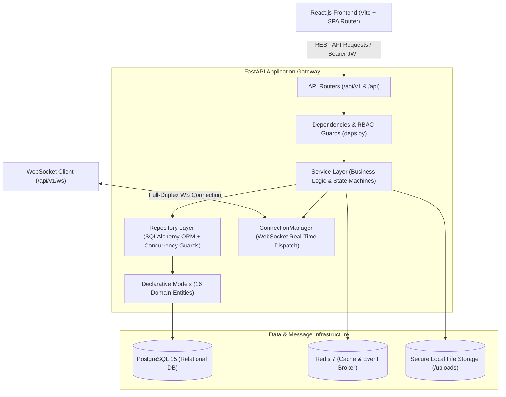

# System Architecture & Technical Specifications

**Collaborative Event & Resource Booking Platform**

---

## 1. High-Level Architecture Diagram



---

## 2. Layered Architecture Pattern

The system strictly adheres to the Clean Enterprise Layered Architecture:

```
Routes
  ↓
Dependencies
  ↓
Services
  ↓
Repositories
  ↓
Models
  ↓
PostgreSQL Database
```

### Layer Responsibilities
1. **API Routers (`app/api/v1/endpoints/`)**:
   - Solely responsible for mapping HTTP methods, parsing input requests, validating query/path parameters, and returning Pydantic schemas.
   - Zero business logic is embedded in route handlers.
2. **Dependencies (`app/api/deps.py`)**:
   - Injects database session context (`get_db`) with automatic commit/rollback.
   - Decodes JWT bearer tokens, authenticates active users, and validates role permissions (`require_super_admin`, org admin checks).
3. **Service Layer (`app/services/`)**:
   - Enforces business rules and state machines (Event status transitions, Waitlist promotions, Magic byte inspection).
   - Coordinates multi-entity transactions and triggers notifications & audit logs.
   - Raises domain-specific exceptions (`AppException`, `DomainException`) with machine-readable codes.
4. **Repository Layer (`app/repositories/`)**:
   - Encapsulates all database queries and writes.
   - Implements transactional row-locking (`with_for_update()`) to prevent race conditions during concurrent bookings and registrations.
5. **Model Layer (`app/models/`)**:
   - Declarative SQLAlchemy models with foreign keys, check constraints, composite unique indexes, and cascade delete rules.

---

## 3. Concurrency & Overlap Prevention Engine

### Double Booking Prevention (Resource Reservations)
To guarantee that two concurrent requests cannot double-book a resource (e.g. Room A booked 10:00–11:00 and another requesting 10:30–11:30):

```sql
SELECT * FROM resource_bookings
WHERE resource_id = :resource_id
  AND status NOT IN ('cancelled', 'rejected')
  AND start_time < :requested_end_time
  AND end_time > :requested_start_time
FOR UPDATE;
```

If any active booking satisfies `[new_start < existing_end AND new_end > existing_start]`, the booking is immediately rejected with `RESOURCE_ALREADY_BOOKED` (HTTP 409 Conflict).

### Automatic Waitlist Promotion Engine
When an event reaches maximum capacity, incoming registrants receive `waitlisted` status and an enqueued position in `waitlist_entries`.
When an existing attendee cancels their registration:
1. An atomic transaction locks the event's registration and waitlist rows (`with_for_update()`).
2. The cancelling registration status is updated to `cancelled`.
3. The lowest position waitlisted entry (`ORDER BY position ASC LIMIT 1`) is selected.
4. The entry is automatically promoted to `confirmed`.
5. Remaining waitlist queue positions are recalculated.
6. A real-time notification (`Registration Confirmed`) is pushed via WebSockets to the promoted participant.

---

## 4. Security & Authentication Architecture

1. **Password Hashing**:
   - Uses Argon2 via `pwdlib` (`argon2-cffi`), resisting GPU-based brute-force attacks.
2. **JWT Token Rotation**:
   - Short-lived Access Tokens (30 minutes expiry).
   - Long-lived Refresh Tokens (7 days expiry) stored with revocation status in `refresh_tokens`.
   - Refresh token rotation issues a new token pair and revokes the used refresh token, preventing replay attacks.
3. **Inactive User Defense**:
   - Inactive accounts are barred at both authentication and token refresh endpoints (`USER_INACTIVE`).
4. **File Magic-Byte Content Inspection**:
   - File uploads reject spoofed MIME extensions by reading initial magic bytes (e.g., `%PDF-` for PDFs, `\x89PNG` for PNGs, `\xff\xd8\xff` for JPEGs).

---

## 5. Role-Based Access Control (RBAC) Matrix

| Feature / Action | Super Admin | Org Admin | Event Manager | Staff | Participant |
| :--- | :---: | :---: | :---: | :---: | :---: |
| Create Organization | ✅ | ❌ | ❌ | ❌ | ❌ |
| Manage Organization Members | ✅ | ✅ | ❌ | ❌ | ❌ |
| Create & Publish Events | ✅ | ✅ | ✅ | ❌ | ❌ |
| Cancel & Archive Events | ✅ | ✅ | ✅ | ❌ | ❌ |
| Register for Events | ✅ | ✅ | ✅ | ✅ | ✅ |
| Cancel Own Registration | ✅ | ✅ | ✅ | ✅ | ✅ |
| Approve/Reject Registrations | ✅ | ✅ | ✅ | ✅ | ❌ |
| Create Bookable Resources | ✅ | ✅ | ❌ | ❌ | ❌ |
| Book Resources | ✅ | ✅ | ✅ | ✅ | ❌ |
| Approve/Reject Resource Bookings | ✅ | ✅ | ❌ | ❌ | ❌ |
| Check-In Attendance (QR Code) | ✅ | ✅ | ✅ | ✅ | ❌ |
| Export Attendance CSV | ✅ | ✅ | ✅ | ✅ | ❌ |
| Post Comments & @Mentions | ✅ | ✅ | ✅ | ✅ | ✅ |
| Upload Event Attachments | ✅ | ✅ | ✅ | ✅ | ❌ |
