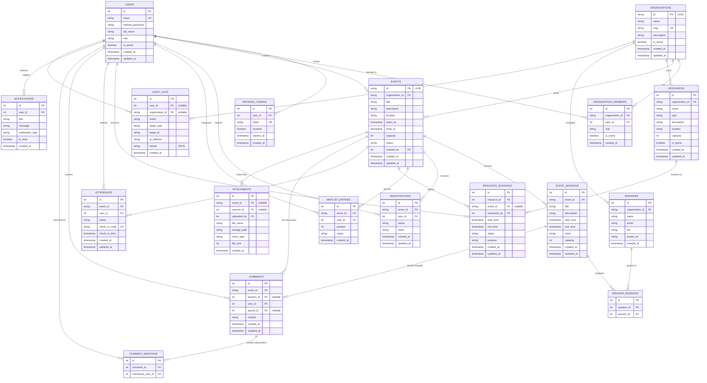

# Collaborative Event & Resource Booking Platform - Database ER Diagram & Architecture

This document provides the complete database entity-relationship (ER) model and architectural constraints for the **Collaborative Event & Resource Booking Platform**.

---

## 1. Entity-Relationship Diagram (Mermaid)

---

## 2. Table-by-Table Architectural Description

| Table Name | Purpose | Critical Constraints & Indexes |
| :--- | :--- | :--- |
| **`users`** | Core user credentials, roles, and status | `UNIQUE(email)`, indexed by `email` and `role`. Prevents inactive user authentication. |
| **`refresh_tokens`** | JWT token rotation & revocation tracking | `UNIQUE(token)`, FK `user_id -> users.id` with `CASCADE`. |
| **`organizations`** | Multi-tenant organization boundaries | `UNIQUE(slug)`, indexed by `is_active`. |
| **`organization_members`** | User membership and RBAC within organizations | `UNIQUE(organization_id, user_id)`. Last active admin protected by business logic. |
| **`events`** | Event metadata, time window, status machine | Status check: `draft`, `published`, `ongoing`, `completed`, `cancelled`, `archived`. Time check: `ends_at > starts_at`. |
| **`event_sessions`** | Breakout sessions within event window | Session start/end validated within parent event window. Room conflict validation. |
| **`speakers`** | Speaker profiles assignable to sessions | Indexed by `organization_id` and `email`. |
| **`speaker_sessions`** | Many-to-many link between speakers and sessions | `UNIQUE(speaker_id, session_id)`. Time conflict validation prevents overlapping assignments. |
| **`resources`** | Bookable rooms, equipment, vehicles | Types: `meeting_room`, `conference_hall`, `projector`, `camera`, `vehicle`, `equipment`. |
| **`resource_bookings`** | Resource reservation records | Double booking prevention via SQL interval overlap check: `[start_1 < end_2 AND end_1 > start_2]` with DB row-locking (`FOR UPDATE`). |
| **`registrations`** | Participant event attendance registrations | `UNIQUE(event_id, user_id)`. Status machine: `pending`, `confirmed`, `waitlisted`, `cancelled`, `rejected`, `attended`, `noshow`. |
| **`waitlist_entries`** | Priority FIFO queue for capacity overflow | Ordered by `position ASC`. Atomic promotion upon cancellation with row locks. |
| **`attendance`** | Participant check-in records | `UNIQUE(event_id, user_id)`. `check_in_code` unique token for QR scanning. |
| **`attachments`** | Uploaded event documents & media | Magic-byte MIME validation (PDF, PNG, JPG). Extension spoofing protection. |
| **`comments`** | Discussion threads on events & sessions | Hierarchical parent-reply structure with threaded back-populates. |
| **`comment_mentions`** | `@username` mention detection | Dispatches real-time WebSocket notifications to mentioned users. |
| **`notifications`** | Persistent system notifications | Indexed by `(user_id, is_read, created_at)`. |
| **`audit_logs`** | Compliance & security activity tracking | Records actor, action, timestamp, IP address, and JSON diff payload. |
